# 实施计划：《Java for PHP Programmers》书籍与教程编写方案

## 一、项目目标与可行性评估

### 1. 项目背景与现实诉求
在现代互联网工程实践中，从 **PHP 技术栈过渡或扩展到 Java 技术栈** 是整个软件行业发生频率最高、覆盖受众最广的架构升级与职业转型场景之一：
- **初创到中大型企业演进**：大量知名互联网公司（如阿里、美团、滴滴、字节跳动等早期阶段）都曾经历从 PHP 敏捷单体过渡到 Java 高可用微服务分布式架构的历史进程。
- **业务规模瓶颈**：随着数据规模突破亿级、并发 QPS 达到数万至数十万、分布式事务与强一致性成为刚需，PHP 的经典单请求隔离（Shared-Nothing）机制在面临跨服务事务协调、大规模线程级并发调度、高吞吐流处理（Kafka/Flink）等场景时面临显著的工程协作天花板。
- **架构师与全栈视野**：国内及海外企业普遍要求资深工程师兼具动态脚本语言的敏捷交付思维与工业级静态编译语言的底层系统设计能力。

### 2. 可行性结论：高度可行且具备强大差异化价值
市场上现存的 Java 教程大多面向零基础学生或 C/C++ 转行者，篇幅冗长且大量重复基础编程概念（如“什么是循环”、“什么是类”）。
面向 PHP 资深工程师的专业教程处于**严重供给不足**的状态。PHP 开发者已经深谙 MVC、IoC/DI（Laravel Container）、ORM（Eloquent）、RESTful API、MySQL 索引优化以及缓存设计，他们需要的是：
1. **心智断层的精准跨越**：直接聚焦“Shared-Nothing 单请求隔离 vs JVM 堆内常驻多线程”、“动态弱类型 vs 编译期强类型与类型擦除”、“Zend GC vs JVM 分代垃圾收集”等核心认知转换。
2. **现代 Java 特性直通**：跳过落后的 Java 6/7 远古包袱，直接拥抱 **Java 17/21 LTS**（Records、Pattern Matching、Virtual Threads 虚拟线程）与 **Spring Boot 3.x** 现代化技术栈。
3. **架构共存与无缝重构方案**：不仅教 Java 开发，更教如何在现有的 PHP 业务集群中平滑引入 Java 微服务（通过 gRPC、RocketMQ、Canal 与网关路由实现渐进式重构）。

---

## 二、核心心智映射表（Mental Model Bridge）

| 维度 / 概念 | PHP（PHP 8+ 生态） | Java（Java 17/21+ 生态） | 心智转换要点与避坑准则 |
| :--- | :--- | :--- | :--- |
| **运行时进程模型** | PHP-FPM 多进程，单请求生命周期（Shared-Nothing） | JVM 单一长驻进程，单进程多线程模型（堆内存全局共享） | **重大转换**：不能再假设“请求结束内存全部重置”；必须谨防全局静态集合泄露、多线程并发修改竞态 |
| **类型系统** | 动态弱类型，逐步演进为渐进类型（Union/Intersection Types） | 静态强类型，编译期类型检查，类型推导（`var`） | 消除运行时隐式类型转换带来的黑盒行为，理解编译期拦截与安全保证 |
| **基本类型与对象** | 没有基础/包装之分，数值自动升级（如整型溢出转浮点） | 基本类型（`int`/`long` 等）与包装类（`Integer`/`Long`） | 深入理解栈上值与堆上对象的性能差异，警惕自动拆箱导致的 `NullPointerException` (NPE) |
| **异常控制流** | `try/catch/finally`，弱受检，大量运行时 Error | 分为 Checked Exception（受检异常）与 RuntimeException | 必须习惯显式处理或向上声明受检异常（`throws`），利用 `try-with-resources` 自动管理资源 |
| **万能数据结构** | 万能哈希数组 `array`（关联字典、有序列表、堆栈全包） | Java 集合框架（`List`、`Set`、`Map`、`Queue`） | 告别 `array` 走天下；掌握 `ArrayList` vs `LinkedList`，`HashMap` 的红黑树阈值与 `ConcurrentHashMap` 的分段/CAS 安全机制 |
| **面向对象范式** | Class 单继承、`interface`、`trait` 代码横向混入 | Class 单继承、`interface` 显式多契约（Java 8+ 默认方法） | Java 没有 Trait 混入，采用接口默认方法（Default Method）或组装模式（Composition）实现行为复用 |
| **数据载体建模** | PHP 8 构造器属性提升、Readonly 类、关联数组 | Java 14+ `record`（不可变数据载体），Lombok `@Data` | 告别手动编写大量 Getter/Setter，用不可变 Record 简化 DTO 与领域值对象 |
| **包管理与构建** | Composer (`composer.json`, `composer.lock`, PSR-4) | Maven (`pom.xml`) / Gradle (`build.gradle`)，坐标体系 | 理解生命周期模型（Compile/Test/Package），多模块继承与聚合，Fat JAR 胖包与类加载机制 |
| **元编程与反射** | 魔术方法（`__call`/`__get`）、属性（Attribute）、动态类载入 | 注解（Annotation）、反射（Reflection）、字节码动态代理（CGLIB/ASM） | 从运行时黑盒解释转变为框架容器基于注解与代理的 AOP 切面增强 |
| **框架设计哲学** | Laravel（IoC Container, Facade 门面, Eloquent 动态魔术） | Spring Boot 3（Spring Core IoC/DI, AOP 代理, Bean 生命周期） | 深入理解单例 Bean 在多线程环境下的线程安全性，严禁在 Bean 中定义有状态的成员变量 |
| **持久层模式** | Active Record 模式（Eloquent, ThinkORM） | Data Mapper 模式（MyBatis / MyBatis-Plus / Spring Data JPA） | 告别模型类与数据库表直接强绑定的 Active Record，进入领域实体与持久层映射分离的架构范式 |
| **并发与高性能** | Swoole 协程、Workerman 多进程、FPM 隔离 | JMM 原生多线程、锁机制、线程池、Java 21 虚拟线程（Project Loom） | 虚拟线程无需改写为响应式非阻塞代码，以同步编程风格享受与 Swoole 相当的超高并发吞吐 |

---

## 三、全书结构与知识图谱

```mermaid
flowchart TD
    ROOT["《Java for PHP Programmers》"]
    
    ROOT --> P1["第一部分：语言基础与心智重塑<br>(Part I: Mindset Shift & Syntax)"]
    ROOT --> P2["第二部分：突破心智关与工程核心<br>(Part II: Engineering Core & JVM)"]
    ROOT --> P3["第三部分：框架实战、企业架构与生态融合<br>(Part III: Frameworks & Enterprise Stack)"]

    P1 --> CH01["01. 动机与破局：为什么 PHP 开发者需要学习 Java？"]
    P1 --> CH02["02. 工具链起步：从 Composer 到 Maven / Gradle 与 JDK 生态"]
    P1 --> CH03["03. 类型系统蜕变：从动态弱类型到强类型、装箱与确定性"]
    P1 --> CH04["04. 流程控制与现代语法：Pattern Matching、Record 与新特性"]
    P1 --> CH05["05. 集合框架大起底：告别万能 Array，拥抱 List、Set 与 Map"]
    P1 --> CH06["06. 面向对象进化：从 Class/Trait 到接口默认方法与抽象契约"]

    P2 --> CH07["07. 健壮的异常机制：Checked 异常与 try-with-resources"]
    P2 --> CH08["08. 真正理解泛型：从 PHPDoc 伪泛型到类型擦除与通配符"]
    P2 --> CH09["09. 元编程与切面：注解、反射与 Spring AOP 动态代理"]
    P2 --> CH10["10. 内存模型与 GC：从 zval 引用计数到 JVM 堆栈与垃圾收集器"]
    P2 --> CH11["11. 并发与多线程：从 Shared-Nothing 到 JMM、线程池与锁"]
    P2 --> CH12["12. 虚拟线程与新并发：Java 21 Project Loom 对决 Swoole 协程"]

    P3 --> CH13["13. 框架决胜：Laravel 与 Spring Boot 3 核心体系深度映射"]
    P3 --> CH14["14. 数据持久化：ActiveRecord (Eloquent) 到 Data Mapper (MyBatis / JPA)"]
    P3 --> CH15["15. 企业级微服务全家桶：Nacos、Gateway、RocketMQ 与高可用"]
    P3 --> CH16["16. 最佳实践与罗塞塔石碑：PHP / Java 语法与生态终极速查"]
    P3 --> CH17["17. 综合实战与平滑迁移：绞杀者模式重构核心业务实战"]
```

---

## 四、各章节详细编写规划与内容提要

### 【第一部分：语言基础与心智重塑】

#### 01. 动机与破局：为什么 PHP 开发者需要学习 Java？
- **PHP 的生产力奇迹与隐形天花板**：Shared-Nothing 带来的无忧容错与高吞吐瓶颈；CPU 密集计算、海量长连接、分布式全局事务的局限。
- **Java 现代工业级地位**：从“笨重老旧”到“极速现代化”（GraalVM AOT 编译、Java 21 虚拟线程、Spring Boot 3 原生镜像）。
- **双引擎架构的威力**：PHP 作为极致敏捷的业务聚合与前台交付层，Java 作为高可靠、高并发、强一致的底层核心服务层。

#### 02. 工具链起步：从 Composer 到 Maven / Gradle 与 JDK 生态
- **JDK 版本的选择**：为什么直接跳过 Java 8，选择 Java 17 / 21 LTS？OpenJDK、Temurin、Oracle JDK 发行版区别。
- **构建工具全面对标**：
  - `composer.json` vs `pom.xml`（GAV 坐标机制：groupId / artifactId / version）。
  - PSR-4 目录映射与 Java Package 目录命名规范。
  - 依赖生命周期与打包：`composer install` vs `mvn clean package`，Fat JAR 与 `java -jar` 执行原理。
- **开发利器配置**：IntelliJ IDEA 核心技巧对比 PhpStorm。

#### 03. 类型系统蜕变：从动态弱类型到强类型、装箱与确定性
- **弱类型与动态求值的陷阱**：PHP 中的 `'123' == 123`、`0 == 'foo'` 历史包袱与 Java 的编译期绝对安全。
- **8 种基本数据类型**：`byte`, `short`, `int`, `long`, `float`, `double`, `char`, `boolean` 的内存尺寸。
- **包装类型（Wrapper Classes）与自动装箱（Autoboxing）**：
  - `int` vs `Integer`。
  - 整数缓存池（IntegerCache -128~127）引发的 `==` 与 `equals()` 经典大坑。
  - 自动拆箱触发隐式 `NullPointerException` 的防范。

#### 04. 流程控制与现代语法：Pattern Matching、Record 与新特性
- **增强流程控制**：传统 `switch-case` 到现代 Switch 表达式与类型模式匹配（Pattern Matching for switch）。
- **不可变数据模型**：
  - PHP 8 Constructor Promotion 与 Readonly Class。
  - Java 14+ `record` 核心机制：自动生成 `canonical constructor`、`equals`、`hashCode`、`toString`。
- **密封类（Sealed Classes）**：使用 `sealed` / `permits` 实现编译期受限的类型继承树。

#### 05. 集合框架大起底：告别万能 Array，拥抱 List、Set 与 Map
- **PHP Array 的底层本质**：Zend 引擎中的 `Zend_Array`（双向链表 + 哈希散列表的混合体）。
- **Java 集合三大基石**：
  - `List`：`ArrayList`（动态数组，连续内存）vs `LinkedList`（双向链表，随机访问劣化）。
  - `Set`：`HashSet`（基于 HashMap 实现的唯一集）、`TreeSet`（红黑树自然排序）。
  - `Map`：`HashMap` 扩容机制与“链表转红黑树（阈值 8）”、`LinkedHashMap`（保持访问或插入顺序）。
- **并发集合与避坑**：`ConcurrentHashMap` 相比 PHP 共享内存（APCu/Swoole Table）的巨大优势；集合遍历中的 `ConcurrentModificationException`。

#### 06. 面向对象进化：从 Class/Trait 到接口默认方法与抽象契约
- **抽象类 vs 接口**：Java 8 引入 `default method` 后的接口能力变迁。
- **如何优雅替代 PHP Trait**：
  - 组合优于继承（Composition over Inheritance）。
  - 接口默认方法作为富接口（Rich Interface）的实践。
- **枚举（Enum）的降维打击**：Java Enum 是拥有独立字段、方法、接口实现的完整面向对象类型，对比 PHP 8 Backed Enum。

---

### 【第二部分：突破心智关与工程核心】

#### 07. 健壮的异常机制：Checked 异常与 try-with-resources
- **异常体系继承树**：`Throwable` -> `Error`（JVM 级灾难）与 `Exception`。
- **受检异常（Checked Exception）的哲学**：为什么编译器强迫你写 `try-catch` 或声明 `throws`？
- **资源释放自动化**：PHP 的析构函数 `__destruct()` 与垃圾回收延迟 vs Java `AutoCloseable` 与 `try-with-resources` 语法块。
- **业务通用异常设计最佳实践**：自定义 `BusinessException` 与全局统一异常处理器。

#### 08. 真正理解泛型：从 PHPDoc 伪泛型到类型擦除与通配符
- **伪泛型与真检查**：PHPStorm `@template T` 的弱注释与 Java 编译期泛型检查。
- **类型擦除（Type Erasure）之谜**：为什么编译后 `List<String>` 和 `List<Integer>` 字节码是同一个？
- **通配符上界与下界（PECS 原则）**：`? extends T` 与 `? super T` 的生产级用法。

#### 09. 元编程与切面：注解、反射与 Spring AOP 动态代理
- **注解（Annotation）vs PHP 8 属性（Attribute）**：生命周期保留策略（`SOURCE`, `CLASS`, `RUNTIME`）。
- **Java 反射机制**：运行时读取类元信息、实例化对象、调用私有成员。
- **动态代理与 AOP**：
  - JDK 动态代理（基于接口） vs CGLIB（基于子类字节码增强）。
  - 告别 Laravel 的魔术方法中间件，领略 Spring AOP 声明式事务（`@Transactional`）与日志切面的实现底细。

#### 10. 内存模型与 GC：从 zval 引用计数到 JVM 堆栈与垃圾收集器
- **PHP 内存管理回顾**：`zval` 结构、`refcount`、环状引用垃圾收集缓冲区。
- **JVM 内存布局全面解析**：
  - 堆（Heap）：年轻代（Eden, Survivor 0/1）与老年代（Old Gen）。
  - 元空间（Metaspace）：类元信息、常量池替代永久代。
  - 线程栈（Thread Stack）：每个线程独立的局部变量表与操作数栈。
- **主流垃圾收集器演进**：Parallel GC -> CMS -> G1 -> 超低停顿 ZGC。
- **内存泄漏排查实战**：ThreadLocal 泄露、静态集合持续占用，以及如何使用 Arthas 与 jmap 抓取分析堆转储。

#### 11. 并发与多线程：从 Shared-Nothing 到 JMM、线程池与锁
- **心智剧震**：从单请求隔离到内存级并发读写冲突。
- **Java 内存模型（JMM）**：可见性、有序性与原子性；`volatile` 关键字的内存屏障语义。
- **线程同步与锁体系**：
  - 内置锁 `synchronized` 与锁升级机制（偏向锁 -> 轻量级锁 -> 重量级锁）。
  - JUC 显式锁：`ReentrantLock`、`ReentrantReadWriteLock`。
  - 原子操作类（`AtomicInteger`、`LongAdder`）与 CAS 原理。
- **线程池（ThreadPoolExecutor）生产级参数配置**：核心线程数、最大线程数、任务队列与四种拒绝策略。

#### 12. 虚拟线程与新并发：Java 21 Project Loom 对决 Swoole 协程
- **高并发技术路线对比**：Swoole/Fibers 协程 vs Go Goroutine vs Java 21 Virtual Threads。
- **虚拟线程的颠覆性**：无须学习复杂的 Reactive / WebFlux 响应式框架，以传统的同步阻塞代码跑出百万级并发吞吐。
- **虚拟线程的调度原理**：载体线程（Carrier Thread）、挂起与恢复、固定（Pinning）陷阱与规避方法。

---

### 【第三部分：框架实战、企业级架构与生态融合】

#### 13. 框架决胜：Laravel 与 Spring Boot 3 核心体系深度映射
- **容器与依赖注入对比**：
  - Laravel Service Container (`app->bind()`, `make()`, ServiceProvider)。
  - Spring IoC / DI (`@Component`, `@Service`, `@Autowired`, `@Configuration`, `@Bean`)。
- **请求生命周期与路由**：
  - Laravel Kernel -> Middleware -> Controller。
  - Spring MVC DispatcherServlet -> HandlerInterceptor -> ControllerAdvice。
- **配置体系与多环境配置**：`.env` 与 `config/*.php` vs `application.yml` 与 Spring Profiles。

#### 14. 数据持久化：ActiveRecord (Eloquent) 到 Data Mapper (MyBatis / JPA)
- **两种持久化模式的理念交锋**：
  - Active Record：业务实体与数据库表耦合，敏捷但大型系统职责过重。
  - Data Mapper：领域实体是纯粹 POJO，数据库操作全由 Mapper 负责。
- **MyBatis-Plus 极速上手**：动态 SQL 构建、分页插件、通用 CRUD。
- **多数据源配置与声明式事务**：`@Transactional` 的传播属性（Propagation）与事务失效的 7 大坑。

#### 15. 企业级微服务全家桶：Nacos、Gateway、RocketMQ 与高可用
- **服务注册与动态配置中心**：Nacos / Consul 体系。
- **API 网关建设**：Spring Cloud Gateway 路由、断言与过滤规则。
- **分布式消息队列实战**：RocketMQ / Kafka 在高并发削峰、解耦、分布式事务最终一致性中的应用。
- **分布式事务与熔断限流**：Seata 框架与 Alibaba Sentinel 高可用防护。

#### 16. 最佳实践与罗塞塔石碑：PHP / Java 语法与生态终极速查
- **语法与函数对照速查表**：字符串、数组/集合、数学计算、时间日期（Carbon vs `java.time.LocalDateTime`）。
- **设计模式在两套语言中的典型实现对比**：单例、工厂、观察者、策略模式。
- **PHP 开发者常见 Java 编码踩坑 Top 20**。

#### 17. 综合实战与平滑迁移：绞杀者模式重构核心业务实战
- **真实业务场景设定**：高并发电商/营销活动中心。
- **渐进式演进策略**：
  1. 第一阶段：PHP 保持前端不变，核心计算与支付通过 gRPC 代理给 Java 服务；
  2. 第二阶段：通过 Canal 监听 MySQL Binlog，无缝实现 PHP 与 Java 数据库双向实时同步；
  3. 第三阶段：网关层按灰度权重切换流量，完成单体系统的平滑解体。
- **全流程验收与监控告警体系建立**。

---

## 五、实施步骤与时间表

| 阶段 | 周期 | 核心交付物 | 质量目标与验收准则 |
| :--- | :--- | :--- | :--- |
| **阶段一：基石搭建** | Day 1-2 | `README.md`, `PLAN.md`, `book.toml`, `custom.css/js`, CI 工作流, `SUMMARY.md` | 本地与 CI 自动化构建全通过，结构清晰完整 |
| **阶段二：核心认知重塑** | Day 3-5 | Part I（01~06章）精撰 | 建立清晰的类型系统、集合与面向对象对照，代码示例可执行 |
| **阶段三：突破工程与底层** | Day 6-8 | Part II（07~12章）精撰 | 攻克 JVM、多线程、虚拟线程与异常机制心智断层，图文并茂 |
| **阶段四：企业级框架与实战** | Day 9-11 | Part III（13~17章）精撰 | 完成 Laravel 到 Spring Boot 映射、持久层重构与绞杀者迁移实战 |
| **阶段五：校对与自动化发布** | Day 12 | 全书交叉审核、排版优化、在线 GitHub Pages 部署验证 | 索引完整，交互体验顺畅，无死链与格式错误 |
