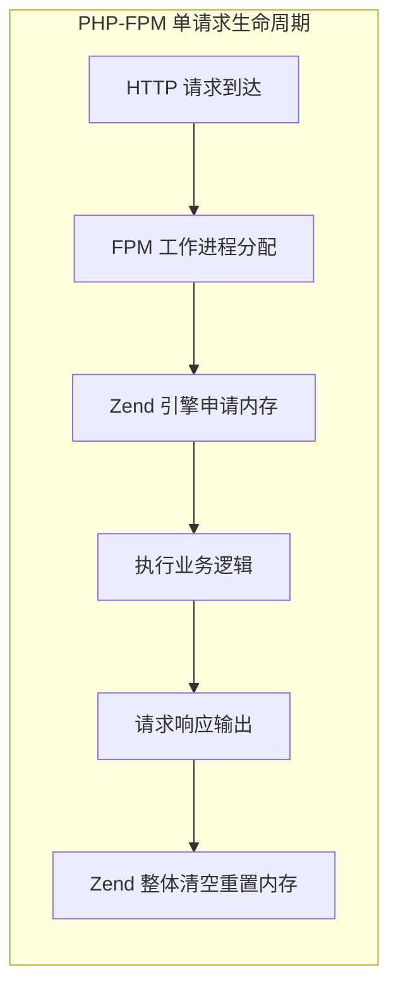
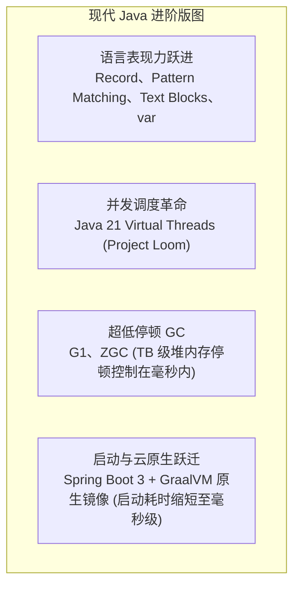

# 01. 动机与破局：为什么 PHP 开发者需要学习 Java？

> “PHP 是极致敏捷的业务冲锋枪，而 Java 是支撑千亿级业务长治久安的工业重型装甲。”

作为一名经验丰富的 PHP 开发者，你或许已经用 Laravel 或 ThinkPHP 架构过多个上线业务，甚至利用 Swoole、Workerman 或 Webman 支撑过数万并发的即时通讯与实时推送。

你可能产生过这样的疑惑：**“PHP 8 已经有了 JIT，语法越来越现代，生态也足够成熟，我为什么还要耗费心力跨入 Java 的世界？”**

本章将直击核心痛点，剖析 PHP 在业务规模爆发式增长后的工程天花板，以及 Java 能够为你的技术体系带来的维度跃迁。

---

## 1. PHP 的生产力红利与隐形天花板

PHP 之所以在过去二十年中成为 Web 开发的统治级语言，根本原因在于其 **Shared-Nothing（无共享状态）** 的运行哲学：



- **极高的容错性**：即使一个请求发生了未捕获的 Fatal Error，或者出现了轻微的内存泄露，随着请求结束，整个进程的内存上下文被底层强行重置，下一个请求永远是干干净净的。
- **极致的开发交付速度**：修改代码无需编译打包，保存即刷新；无需操心复杂的对象生命周期与跨线程资源竞争。

### 然而，当业务规模跃升至企业级时，天花板在以下场景集中显现：

1. **分布式事务与强一致性诉求**：
   - 在电商扣减库存、银行对账、跨服务转账等金融级场景中，需要严苛的 2PC、TCC 或 SAGA 事务保障；
   - PHP 生态缺乏被全球头部互联网公司深度验证的高性能分布式事务中间件（如 Java 生态中的 Seata），基于 PHP 手写状态机容错成本极高。
2. **高吞吐数据流与消息驱动架构**：
   - 在每秒几十万条日志分析、指标收集或风控特征实时计算场景中，Kafka、Apache Flink、Pulsar 是标准基础设施；
   - 这些大数据和流计算引擎的原生 SDK 和底层体系全建立在 JVM 之上。PHP 客户端在消费者群组重平衡（Rebalance）、高吞吐批处理拉取、内存级背压（Backpressure）控制上存在先天短板。
3. **跨请求的内存级状态共享**：
   - 在 PHP-FPM 模式下，多个请求之间无法直接共享内存数据，必须频繁跨网络读写 Redis / Memcached。
   - 相比之下，Java 可以在 JVM 堆内维护百万级商品属性的本地缓存（如 Caffeine），单次获取仅需几十纳秒且零网络开销，性能高出数个数量级。
4. **常驻内存与多进程调度的运维心智困境**：
   - 尽管常驻内存框架（Swoole/Workerman）大幅提升了吞吐，但多进程架构下的连接池管理、死锁检测、进程挂死自愈、内存缓慢膨胀等问题，缺少像 Java 生态那样成熟的可视化诊断工具（如 Arthas、JProfiler、MAT、VisualVM）。

---

## 2. 认识现代 Java：告别陈旧刻板印象

不少 PHP 工程师对 Java 的印象还停留在 Java 6 / 7 时代的“臃肿”、“样板代码漫天飞”、“启动缓慢”，但如今的 Java 生态早已发生了翻天覆地的进化：



### 现代 Java 带来的核心硬核实力：

1. **严苛的编译期质量保障**：
   - 静态强类型系统让所有接口调用、参数传递、空指针隐患在 IDE 编码与编译阶段无所遁形，极大地减轻了大型团队协作时的重构恐惧症。
2. **世界级的虚拟机工程奇迹（HotSpot JVM）**：
   - 具备 C1 / C2 分层 JIT 即时编译能力，能够基于运行时热点代码进行动态内联、逃逸分析与栈上分配；
   - 现代化垃圾收集器（如 ZGC）能够在管理数百 GB 堆内存的同时，将 GC 停顿时间（STW）控制在 **1 毫秒** 以内。
3. **Java 21 虚拟线程（Project Loom）**：
   - 彻底颠覆高并发服务端编程模型！无需为了高并发而重构代码为复杂的异步响应式（Reactive/Mono/Flux）；
   - 以传统的同步阻塞书写方式，轻松支撑百万级并发请求，与 Swoole 协程的编程心智完美呼应。

---

## 3. 企业级演进：PHP + Java 双剑合璧

在企业实战中，最佳策略往往不是“非此即彼”的全面推翻，而是**优势互补的混合架构**：

```mermaid
flowchart LR
    Client[客户端 App / 浏览器] --> Gateway[API 网关 / Nginx]
    
    subgraph 敏捷前台层 (PHP)
        Gateway --> PHP1[Laravel / Webman BFF 聚合层]
        Gateway --> PHP2[运营活动 / CMS / 渠道营销]
    end

    subgraph 工业核心层 (Java)
        PHP1 -. gRPC / RPC 调用 .-> Java1[Spring Boot 用户/订单核心]
        PHP1 -. 异步消息 .-> MQ[(RocketMQ / Kafka)]
        MQ --> Java2[实时清结算 / 账户流水]
        Java1 --> DB[(分库分表集群)]
    end
```

- **PHP 专注前台与快速交付**：负责业务多变的营销活动、渠道快速对接、BFF 接口编排。业务需求今天提、明天上线，发挥 PHP 的敏捷极限。
- **Java 统领核心交易与基础中台**：承载账户资产、交易撮合、库存防超卖、分布式调度与流式计算，提供 99.999% 的工业级稳定性。

---

## 4. 本章小结与思考

1. **思维升级**：从 PHP 的“单请求内存隔离”升级到 Java 的“JVM 进程级常驻多线程”，这是整个学习过程中最关键的心智断层。
2. **工具赋能**：掌握 Java 不仅是一门语言的拓展，更是解锁了整个大数据、微服务治理、分布式高可用的顶级工程工具箱。
3. **思考题**：在你们团队当前的业务中，哪些模块用 PHP 开发感到最吃力、最容易出现性能瓶颈或数据一致性风险？学习 Java 后，你会如何规划这部分的架构改造？
