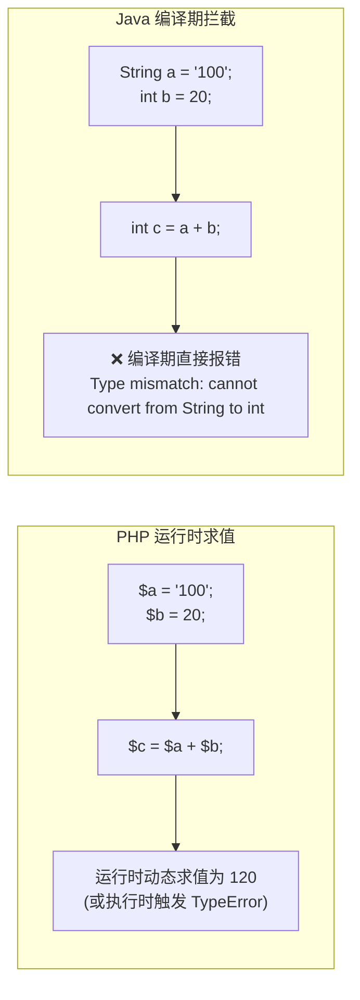

# 03. 类型系统蜕变：从动态弱类型到强类型、装箱与确定性

> “弱类型的灵活在个人原型阶段令人陶醉，强类型的严谨在百人团队演进中拯救生命。”

对于长年使用 PHP 的开发者来说，变量前面的 `$` 符号和随意变更类型的便利性（例如 `$id = 123; $id = "123_TX";`）已经成为肌肉记忆。然而，这种灵活性在大型分布式系统和复杂的企业金融计算中却是一颗随时可能引爆的地雷。

本章将带你彻底跨越类型系统的鸿沟，剖析基本类型、包装类、自动装箱陷阱以及 Java 内存中最危险的经典空指针盲区。

---

## 1. 动态弱类型 vs 编译期静态强类型

PHP 8 虽然引入了类型提示（Type Hints）、联合类型（Union Types，如 `int|string`）以及严格类型声明（`declare(strict_types=1);`），但在本质上仍是一门**动态类型解释型语言**：类型检查主要发生在代码执行的那一瞬间（运行时）。

Java 则是彻底的**编译期静态强类型语言**：
- 每一个变量必须拥有且仅拥有一个确定的类型；
- 类型在声明后不可更改；
- 任何非法的类型转换、未定义的方法调用，在代码编译阶段就会被 `javac` 直接拦截，根本无法打包上线。



---

## 2. Java 八大基本数据类型（Primitives）

与 PHP 中所有标量底层均被包装为 C 语言结构体 `zval` 不同，Java 在语言底层将数据划分为**基本数据类型（Primitive Types）**与**引用数据类型（Reference Types）**。基本类型直接分配在线程栈（Thread Stack）上，拥有极致的内存访问速度。

| 类型关键字 | 位数 (Bits) | 内存占用 | 取值范围 | PHP 对应类型与注意点 |
| :--- | :--- | :--- | :--- | :--- |
| `byte` | 8 | 1 字节 | -128 ~ 127 | 二进制流、网络包常用，PHP 无对应 |
| `short` | 16 | 2 字节 | -32,768 ~ 32,767 | 短整型，PHP 统一为 `int` |
| `int` | 32 | 4 字节 | 约 ±21 亿 | 最常用的整数类型 |
| `long` | 64 | 8 字节 | 约 ±922 亿亿 | 大 ID、雪花算法分布式 ID 必备，**字面量末尾需加 `L`** |
| `float` | 32 | 4 字节 | 单精度浮点数 | **字面量末尾需加 `F`**，精度较低 |
| `double` | 64 | 8 字节 | 双精度浮点数 | 默认浮点类型，对标 PHP `float` |
| `char` | 16 | 2 字节 | 0 ~ 65535 (Unicode) | 单个字符，用单引号 `'A'`，PHP 无字符类型 |
| `boolean` | 1 | JVM 内部优化 | `true` 或 `false` | **只有布尔值**，绝不允许 `if (1)` 或 `if ("")`！ |

> [!CAUTION]
> **严禁在条件语句中使用非布尔值！**  
> 在 PHP 中，`if (count($arr))`、`if ($user_id)` 是极为常见的写法。  
> 但在 Java 中，条件表达式必须是显式的 `boolean`：
> ```java
> // ❌ 错误：Type mismatch: cannot convert from int to boolean
> int count = list.size();
> if (count) { ... }
> 
> // ✅ 正确写法
> if (count > 0) { ... }
> if (userId != null) { ... }
> ```

---

## 3. 包装类型（Wrapper）与自动装箱（Autoboxing）

为了让基本类型能够在面向对象体系（如集合 `List<T>`、泛型）中使用，Java 为每个基本类型提供了对应的引用对象类型，称为**包装类**：

- `int` 对应 `Integer`
- `long` 对应 `Long`
- `boolean` 对应 `Boolean`
- `double` 对应 `Double`

### 自动装箱与自动拆箱：
编译器会自动在基本类型和包装类型之间进行转换：
```java
// 自动装箱：基本类型 int -> 包装类对象 Integer (底层调用 Integer.valueOf(100))
Integer boxed = 100;

// 自动拆箱：包装类对象 Integer -> 基本类型 int (底层调用 boxed.intValue())
int primitive = boxed;
```

### 💣 核心避坑一：自动拆箱引发的 NullPointerException (NPE)
在 PHP 中，`null` 参与整型运算时通常会被隐式转换为 `0`。而在 Java 中，如果包装类型为 `null` 且被隐式拆箱，将直接抛出运行时灾难 NPE：

```java
Integer stock = null; // 比如从数据库查出的库存为空

// ❌ 灾难：此处 stock 触发自动拆箱 stock.intValue()，抛出 NullPointerException！
if (stock > 0) {
    System.out.println("有库存");
}

// ✅ 安全写法：先判空
if (stock != null && stock > 0) {
    System.out.println("有库存");
}
```

### 💣 核心避坑二：`==` 与 `equals()` 的天坑（整数缓存池）
这是 PHP 开发者转 Java 时最容易被扣绩效的经典陷阱！

```java
Integer a = 127;
Integer b = 127;
System.out.println(a == b); // 输出: true！

Integer c = 128;
Integer d = 128;
System.out.println(c == d); // 输出: false！！！为什么？！
```

> [!WARNING]
> **真相大揭秘**：  
> 1. Java 的 `==` 比较的是**内存地址**（对象引用是否指向同一块内存），而不是值！  
> 2. Java 虚拟机内部维护了一个整数常量缓存池（`IntegerCache`），范围是 **-128 到 127**。在此范围内的对象被复用，超出此范围则会 `new` 出新对象！  
> 3. **铁律：在 Java 中比较任何对象（包括 String、Integer、Long）的值，一律使用 `.equals()`，严禁使用 `==`！**
> ```java
> System.out.println(c.equals(d)); // 输出: true (永远正确)
> ```

---

## 4. 局部类型推导：`var` 关键字

Java 10 引入了 `var` 语法糖，允许由编译器自动推导局部变量类型：

```java
// 传统写法
Map<String, List<UserOrder>> userOrderMap = new HashMap<String, List<UserOrder>>();

// 现代 var 写法（等价且类型绝对安全）
var userOrderMap = new HashMap<String, List<UserOrder>>();
```

> [!NOTE]
> `var` 绝不是 PHP 的动态变量！它只是让编译器在编译时根据右侧赋值替你推导写出类型。一旦编译，变量类型即永久固定，不能再赋给其他类型的值。

---

## 5. 常量与不可变性：`final` 关键字

PHP 中定义不可变通常使用 `const` 或 PHP 8.1 引入的 `readonly` 属性。在 Java 中，通用的修饰符是 `final`：
- 修饰局部变量或成员变量：初始化后不可重新赋值（引用的地址不可变）；
- 修饰方法：不可被子类重写（Override）；
- 修饰类：不可被继承（例如 `final class String`）。

```java
// 对标 PHP: public const MAX_RETRY_COUNT = 3;
public static final int MAX_RETRY_COUNT = 3;
```

---

## 6. 字符串与字符串池（String Pool）

在 PHP 中，字符串连接使用点号 `.`（如 `$str = "Hello " . $name;`）。而在 Java 中：
- 连接使用加号 `+`（编译器底层会自动转为 `StringBuilder` 优化）；
- 字符串 `String` 在 Java 中是**不可变对象（Immutable）**；
- 在大量循环拼接时，严禁使用 `+`，必须使用 `StringBuilder` 以避免创建数十万无用中间对象挤爆堆内存：

```java
// ❌ 严禁在长循环中使用 + 拼接
String result = "";
for (int i = 0; i < 10000; i++) {
    result += i; // 每次循环都会在堆中创建新的 String 对象并拷贝！
}

// ✅ 生产级写法
StringBuilder sb = new StringBuilder();
for (int i = 0; i < 10000; i++) {
    sb.append(i);
}
String result = sb.toString();
```

下一章中，我们将进入现代流程控制、模式匹配与 Java 14+ 最激动人心的不可变数据模型 —— **Record**！
