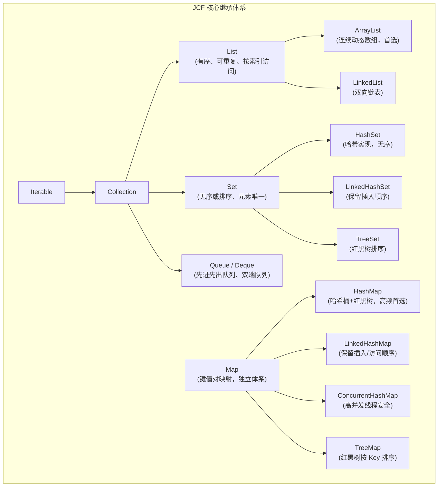

# 05. 集合框架大起底：告别万能 Array，拥抱 List、Set 与 Map

> “PHP 程序员的一个 Array 能装下整个世界，而 Java 工程师必须看清每一个字节的内存布局与时间复杂度。”

在 PHP 开发中，`array` 是当之无愧的“万能瑞士军刀”：
- 它可以是顺序索引列表：`$list = [1, 2, 3];`
- 它可以是哈希关联字典：`$dict = ['name' => 'Tinywan', 'role' => 'admin'];`
- 它可以是堆栈与双端队列：`array_push()` / `array_pop()` / `array_shift()`
- 它甚至能做多维矩阵与集合求交集：`array_intersect()`

然而，这种“无所不能”是有代价的。PHP 的 `array` 底层是 Zend 引擎中庞大的 `Zend_Array`（一个由双向链表与哈希散列表混合构成的复杂结构体），每一个元素都有额外的哈希桶指针与 `zval` 头信息，导致内存开销巨大。

在 Java 中，**根本不存在万能 Array**。Java 提供了分工严密、内存精炼、性能极致的 **Java 集合框架（Java Collections Framework, JCF）**。

---

## 1. Java 集合体系全景图



---

## 2. 顺序列表：`ArrayList` vs `LinkedList`

当你需要 PHP 的纯数值索引数组（如 `$users = ['Alice', 'Bob', 'Charlie'];`）时，在 Java 中应该使用 `List<T>`。

### `ArrayList`（绝大多数场景的首选）：
- 底层是**连续的 Object[] 动态数组**；
- **随机访问极快**：`get(index)` 时间复杂度为 $O(1)$，对 CPU 缓存友好；
- **尾部追加极快**：`add(e)` 均摊时间复杂度为 $O(1)$；当数组容量不足时，自动扩容为原来的 1.5 倍；
- **中间插入/删除较慢**：需要挪动后续所有元素，复杂度为 $O(n)$。

### `LinkedList`：
- 底层是**双向链表**；
- 每次插入都要为 Node 节点单独在堆上分配内存并记录前驱和后继指针，指针开销大，CPU 缓存命中率极差；
- 除非高频在头部插入删除，否则**99% 的生产场景都应坚决选用 `ArrayList`**。

```java
// 创建可变列表
List<String> users = new ArrayList<>();
users.add("Alice");
users.add("Bob");
users.add("Charlie");

// 访问与修改
String first = users.get(0); // 相当于 $users[0]
users.set(1, "David");       // 相当于 $users[1] = 'David'
int size = users.size();     // 相当于 count($users)

// 现代快速构建只读列表（Java 9+）
List<String> immutableList = List.of("A", "B", "C"); // 类似 PHP 只读数组
// immutableList.add("D"); // ❌ 抛出 UnsupportedOperationException！
```

---

## 3. 关联字典：`HashMap` 深度解析

当你需要 PHP 的关联数组（如 `$user = ['id' => 101, 'name' => 'Tinywan'];`）时，对标的就是 `Map<K, V>`。

### `HashMap` 的底层工作原理：
- 由“数组 + 链表 + 红黑树”构成；
- 默认初始容量为 16，负载因子（Load Factor）为 0.75；
- 当一个哈希桶内的冲突链表长度达到 **8** 且总容量达到 64 时，链表会自动转换为**红黑树**，将查找的最坏时间复杂度从 $O(n)$ 降低到 $O(\log n)$；
- 线程不安全（在多线程并发 `put` 时可能产生死循环或数据丢失）。

```java
// 声明与初始化 Map (键为 String，值为 Object)
Map<String, Object> userMap = new HashMap<>();
userMap.put("id", 101L);
userMap.put("name", "Tinywan");
userMap.put("role", "admin");

// 获取数据
String name = (String) userMap.get("name"); // 取值
boolean exists = userMap.containsKey("role"); // 相当于 array_key_exists('role', $arr)

// 现代快速构建小 Map（Java 9+）
Map<String, String> config = Map.of(
    "env", "production",
    "version", "1.0.0"
);
```

### Map 遍历的最佳姿势：
```java
// 相当于 PHP 的 foreach ($userMap as $key => $value)
for (Map.Entry<String, Object> entry : userMap.entrySet()) {
    System.out.println(entry.getKey() + " => " + entry.getValue());
}

// 或者使用现代 forEach Lambda
userMap.forEach((k, v) -> System.out.println(k + " = " + v));
```

---

## 4. 唯一集合：`Set` 系列

在 PHP 中实现“去重”，我们通常使用 `$arr = array_unique($arr)` 或以 key 作为哈希防重。而在 Java 中，直接使用原生 `Set<T>`：

- **`HashSet`**：底层就是基于 `HashMap` 的 Key 实现的，元素无序，查找和去重复杂度均为 $O(1)$；
- **`LinkedHashSet`**：在 HashSet 基础上维护了一条双向链表，记录元素的插入顺序；
- **`TreeSet`**：底层为红黑树，元素会自动按自然顺序或自定义比较器排序。

```java
Set<String> tags = new HashSet<>();
tags.add("Java");
tags.add("PHP");
tags.add("Java"); // 重复添加自动被忽略

System.out.println(tags.size()); // 输出: 2
```

---

## 5. 💣 核心避坑：集合遍历中的并发修改异常

在 PHP 中遍历数组时，如果执行 `unset($arr[$k])`，PHP 的写时复制（Copy-on-Write）或指针移动通常不会崩溃。而在 Java 中，这是最容易踩中的大坑：

```java
List<String> list = new ArrayList<>(List.of("A", "B", "C"));

// ❌ 灾难写法：抛出 ConcurrentModificationException！
for (String item : list) {
    if ("B".equals(item)) {
        list.remove(item); // 严禁在增强 for 循环中直接调用 list.remove()！
    }
}

// ✅ 正确姿势 1：使用迭代器显式安全删除
Iterator<String> iterator = list.iterator();
while (iterator.hasNext()) {
    if ("B".equals(iterator.next())) {
        iterator.remove(); // 安全删除当前元素
    }
}

// ✅ 正确姿势 2：现代 Lambda removeIf（推荐）
list.removeIf(item -> "B".equals(item));
```

---

## 6. 函数式流操作：Stream API vs PHP 数组函数

在现代 PHP 开发中，我们经常使用 `array_map`、`array_filter`、`array_reduce` 或 Laravel Collection 的链式操作。Java 8 引入的 **Stream API** 将这一模式发挥到了极致：

### 对比示例：过滤出已激活用户并提取其邮箱列表

#### PHP (Laravel Collection 风格)
```php
$emails = collect($users)
    ->filter(fn($u) => $u->isActive())
    ->map(fn($u) => $u->getEmail())
    ->values()
    ->all();
```

#### Java Stream API 风格
```java
List<String> emails = users.stream()
    .filter(User::isActive)
    .map(User::getEmail)
    .toList(); // Java 16+ 便捷转换为 List
```

> [!TIP]
> Java 的 Stream 是**惰性求值（Lazy Evaluation）**的。直到执行终端操作（如 `.toList()` 或 `.count()`）前，中间的 `filter` 和 `map` 都不会执行。对于百万级大数据集，只需将 `.stream()` 改为 `.parallelStream()`，即可瞬间利用多核 CPU 进行并行处理！

在下一章中，我们将进入面向对象世界，深入探讨 Class、Interface 默认方法以及如何优雅替代 PHP Trait！
