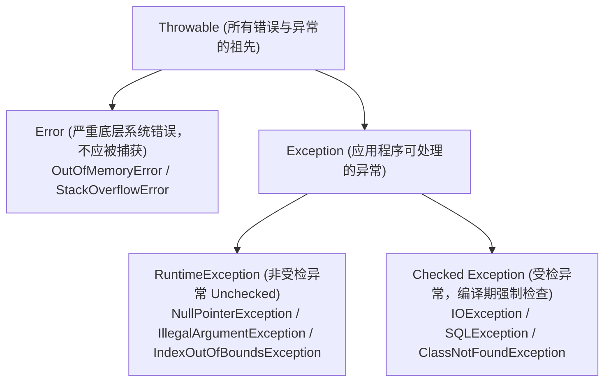

# 07. 健壮的异常机制：Checked 异常与 try-with-resources

> “PHP 把大部分异常当成运行时偶发的插曲，Java 把可预见的失败当成必须显式履行的方法契约。”

在 PHP 开发中，处理异常主要是通过 `try { ... } catch (Throwable $e) { ... }`。如果你漏抓了异常，请求通常会在顶层报错并返回 500，或者在框架的统一 Handler 中兜底记录日志。

当你刚写 Java 代码时，最让你抓狂的一件事往往是：**“为什么我只是调用了一个读写文件或网络请求的方法，编译器就直接标红报错，强制我必须写 try-catch？！”**

这就是 Java 独创并饱受争议、却又极大提升了大型工程健壮性的核心机制 —— **受检异常（Checked Exception）**。

---

## 1. Java 异常继承树结构



### 核心划分界限：
1. **`Error`**：JVM 自身崩溃或系统资源耗尽（如堆内存溢出 `OutOfMemoryError`、栈溢出 `StackOverflowError`）。代码不应该尝试用 `catch` 捕获它们，通常应立刻告警并允许进程终止。
2. **`RuntimeException`（非受检异常，Unchecked）**：程序员逻辑疏忽导致的 Bug（如空指针、数组越界、非法参数）。编译器**不强制**显式捕获或声明。
3. **`Checked Exception`（受检异常）**：所有**直接继承自 `Exception` 但不属于 `RuntimeException`** 的类。它们代表外部不可控的预期故障（如网络抖动、文件不存在、数据库断连）。**编译器强制要求必须处理！**

---

## 2. 受检异常（Checked Exception）的哲学与处理

如果一个方法签名声明了抛出受检异常：
```java
// 方法签名显式声明：调用我可能会抛出 IOException，你必须准备应对方案！
public String readFileContent(String path) throws IOException {
    return Files.readString(Path.of(path));
}
```

调用方只有两种选择，否则编译**绝对无法通过**：

### 选择一：原地捕获并处理（`try-catch`）
```java
public void loadConfig() {
    try {
        String content = readFileContent("/etc/app.conf");
        System.out.println(content);
    } catch (IOException e) {
        System.err.println("配置文件读取失败: " + e.getMessage());
        // 降级使用默认配置
    }
}
```

### 选择二：继续向调用栈上游抛出（`throws` 契约传递）
```java
public void loadConfig() throws IOException {
    String content = readFileContent("/etc/app.conf");
    System.out.println(content);
}
```

> [!TIP]
> **现代工程实践准则**：  
> 过多的受检异常会导致代码充斥着样板 `try-catch`。在现代企业级应用中，业界推崇**“在底层将 Checked 异常包装为自定义的 Unchecked 业务异常（`RuntimeException`）再抛出”**，交由全局统一异常切面拦截：
> ```java
> try {
>     return Files.readString(Path.of(path));
> } catch (IOException e) {
>     // 将底层受检异常作为 cause 封装进业务运行时异常
>     throw new BusinessException(ErrorCode.CONFIG_READ_FAIL, "读取配置失败", e);
> }
> ```

---

## 3. 资源自动释放：`try-with-resources`

在 PHP 中，当打开一个文件流（`fopen`）或数据库连接时，哪怕忘记调用 `fclose`，只要请求结束，PHP 引擎都会自动析构并回收资源。

但在 Java 的长期运行进程中，如果未及时关闭 `InputStream`、`Socket` 或 `Connection`，将直接导致**文件描述符（FD）耗尽**或**数据库连接池被占死**！

### 传统脆弱写法（容易遗漏）：
```java
FileInputStream fis = null;
try {
    fis = new FileInputStream("data.txt");
    // 读取文件...
} catch (IOException e) {
    e.printStackTrace();
} finally {
    if (fis != null) {
        try {
            fis.close(); // finally 里面还要嵌套 try-catch，极其恶心
        } catch (IOException ignored) {}
    }
}
```

### 现代优雅方案：`try-with-resources`（Java 7+）
只要类实现了 `AutoCloseable` 接口，写在 `try (...)` 小括号内的资源，在代码块结束时（无论正常结束还是抛出异常），JVM 都会**100% 保证自动调用 `.close()`**：

```java
// try 括号内的资源会在退出时自动安全关闭！
try (FileInputStream fis = new FileInputStream("data.txt");
     BufferedReader reader = new BufferedReader(new InputStreamReader(fis))) {
    
    String line;
    while ((line = reader.readLine()) != null) {
        System.out.println(line);
    }
} catch (IOException e) {
    log.error("读取异常", e);
}
```

---

## 4. 全局统一异常处理：Laravel 对标 Spring Boot

在 Laravel 中，我们在 `bootstrap/app.php` 或 `Handler.php` 中配置全局兜底；在 Spring Boot 中，使用 `@RestControllerAdvice` 配合 `@ExceptionHandler`：

```java
@RestControllerAdvice
@Slf4j
public class GlobalExceptionHandler {

    // 1. 捕获自定义的业务已知异常
    @ExceptionHandler(BusinessException.class)
    public ApiResponse<Void> handleBusinessException(BusinessException e) {
        log.warn("业务规则校验未通过: {}", e.getMessage());
        return ApiResponse.error(e.getCode(), e.getMessage());
    }

    // 2. 捕获参数校验异常（表单验证失败）
    @ExceptionHandler(MethodArgumentNotValidException.class)
    public ApiResponse<Void> handleValidationException(MethodArgumentNotValidException e) {
        String msg = e.getBindingResult().getFieldError().getDefaultMessage();
        return ApiResponse.error(400, "参数错误: " + msg);
    }

    // 3. 兜底捕获未知的系统严重崩溃
    @ExceptionHandler(Throwable.class)
    public ApiResponse<Void> handleUnknownException(Throwable e) {
        log.error("系统未知致命异常!", e);
        return ApiResponse.error(500, "系统繁忙，请稍后再试");
    }
}
```

---

## 5. 告别显式 null：`Optional<T>` 的正确打开方式

在 PHP 中，我们常用空安全操作符（Nullsafe Operator）`$user?->getProfile()?->getAddress()`。

Java 8 引入了 `Optional<T>` 容器类，用以表达“该值可能存在，也可能为空”，强制调用方直面判空逻辑，根除盲目调用引发的 NPE：

```java
// 业务方法返回 Optional，显式提示“可能查不到用户”
public Optional<User> findUserById(Long id) {
    User user = userMapper.selectById(id);
    return Optional.ofNullable(user);
}

// 优雅链式消费：
String city = findUserById(101L)
    .map(User::getAddress)
    .map(Address::getCity)
    .orElse("默认城市"); // 如果中途任何一个环节为 null，平滑回退为默认值

// 如果不存在则抛出指定业务异常
User user = findUserById(101L)
    .orElseThrow(() -> new BusinessException(404, "用户不存在"));
```

在下一章中，我们将攻克 Java 类型系统的皇冠特质 —— **泛型（Generics）与类型擦除（Type Erasure）**！
