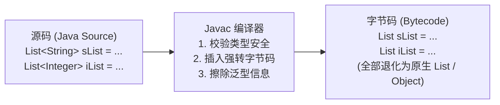

# 08. 真正理解泛型：从 PHPDoc 伪泛型到类型擦除与通配符

> “PHP 用注释假装自己有泛型，Java 用类型擦除在编译期施加魔法。”

在 PHP 开发中，随着 PHPStan、Psalm 和 PhpStorm 的普及，我们经常在代码注释中写下 `@template T`、`@return array<T>` 或 `Collection<int, User>`。但这只是静态分析工具提供的**“伪泛型”**——在 PHP 运行时，解释器对这些泛型标注视若无睹，你可以把任何字符串塞进一个声明为只存整型的数组里。

而在 Java 中，**泛型（Generics）**是第一公民。它不仅能让集合与数据结构复用逻辑，还能在编译阶段牢牢锁死类型安全。但由于 Java 历史向下兼容的包袱，它带来了一个每个 Java 开发者都必须掌握的核心机制 —— **类型擦除（Type Erasure）**。

---

## 1. 泛型的本质：为什么需要它？

在没有泛型的 Java 早期版本中，所有的集合容器内部装的都是最顶层的 `Object`：
```java
// Java 1.4 时代的灾难：
List list = new ArrayList();
list.add("Hello");
list.add(123); // 可以往里乱塞任何东西！

// 取出时必须手动强制类型转换，容易抛出 ClassCastException
String str = (String) list.get(1); // 运行时崩溃！
```

引入泛型后，参数化类型（Parameterized Type）让容器带有了类型约束：
```java
// 现代 Java 泛型：
List<String> list = new ArrayList<>();
list.add("Hello");
// list.add(123); // ❌ 编译期直接拦截！
String str = list.get(0); // 取出无需强转，绝对安全
```

---

## 2. 泛型类、接口与泛型方法

不仅系统集合可以使用泛型，我们在业务开发中也可以自由定义：

### 统一 API 响应包装体（企业级标准）：
```java
public record ApiResponse<T>(int code, String message, T data) {
    public static <T> ApiResponse<T> success(T data) {
        return new ApiResponse<>(200, "success", data);
    }

    public static <T> ApiResponse<T> error(int code, String message) {
        return new ApiResponse<>(code, message, null);
    }
}
```

### 泛型方法定义：
注意：在方法修饰符和返回值之间使用 `<T>` 声明类型形参：
```java
public class JsonUtils {
    // 泛型方法：接收泛型 Class 令牌并返回对应类型的对象
    public static <T> T parse(String json, Class<T> clazz) {
        // 利用 Jackson 或 Fastjson 进行反序列化
        return JacksonMapper.readValue(json, clazz);
    }
}

// 调用时类型自动绑定：
User user = JsonUtils.parse(jsonStr, User.class);
```

---

## 3. 核心机制：类型擦除（Type Erasure）之谜

这是所有初学者最困惑的地方：**Java 的泛型只存在于编译期，在编译为字节码后，所有泛型信息都会被“擦除”！**



### 证明：泛型在运行时是相同的 Class！
```java
List<String> stringList = new ArrayList<>();
List<Integer> intList = new ArrayList<>();

System.out.println(stringList.getClass() == intList.getClass()); 
// 输出: true！它们的运行时运行时类都是 java.util.ArrayList
```

### 类型擦除带来的 4 大硬性限制：
1. **不能使用基本类型作为泛型参数**：
   - ❌ 错误：`List<int>`；
   - ✅ 正确：`List<Integer>`（因为擦除后需要退化为 `Object`，而基本类型无法继承 `Object`）。
2. **不能直接 `new T()`**：
   - 因为在运行时根本不知道 `T` 是什么类，无法直接分配内存实例化。
3. **不能对泛型进行 `instanceof` 判断**：
   - ❌ 错误：`if (obj instanceof List<String>)`；
   - ✅ 正确：`if (obj instanceof List<?>)`。
4. **不能创建泛型数组**：
   - ❌ 错误：`T[] arr = new T[10];`。

---

## 4. 通配符与 PECS 原则

在日常开发中，你可能会发现一个怪现象：
虽然 `Integer` 继承自 `Number`，但是 **`List<Integer>` 并不是 `List<Number>` 的子类**！
```java
List<Integer> intList = new ArrayList<>();
// ❌ 编译报错：Type mismatch!
List<Number> numList = intList; 
```
为了在集合参数传递时支持多态，Java 引入了**通配符（Wildcards `?`）**与 **PECS 原则**：

> [!IMPORTANT]
> **PECS 原则：Producer Extends, Consumer Super**
> - **`? extends T`（上界通配符）**：用于频繁**读取（Produce）**数据的场景；
> - **`? super T`（下界通配符）**：用于频繁**写入（Consume）**数据的场景。

### 上界通配符 `? extends T`（只读安全）：
```java
// 允许传入 List<Integer>、List<Double> 等任何 Number 的子类集合
public static double sumOfList(List<? extends Number> list) {
    double sum = 0.0;
    for (Number n : list) {
        sum += n.doubleValue(); // 读取安全！
    }
    // list.add(10); // ❌ 严禁向其写入！因为不知道集合具体是什么子类型
    return sum;
}
```

### 下界通配符 `? super T`（写入安全）：
```java
// 允许传入 Integer 或其父类（Number, Object）的集合
public static void addNumbers(List<? super Integer> list) {
    list.add(1);  // 写入安全！
    list.add(2);
    // Object obj = list.get(0); // 读取只能得到 Object，丢失具体类型
}
```

---

## 5. 实战避坑：如何反序列化复杂嵌套泛型？

由于类型擦除，如果直接调用 `mapper.readValue(json, List<User>.class)`，编译器会直接语法报错。

在 Jackson 或 Fastjson 中，解决方案是利用**匿名内部类捕获父类泛型元数据**的特殊技巧（`TypeReference`）：

```java
String json = "[{\"id\":1,\"name\":\"Alice\"},{\"id\":2,\"name\":\"Bob\"}]";

// 利用 TypeReference 匿名子类保留的类型签名完成精确反序列化！
List<User> users = objectMapper.readValue(json, new TypeReference<List<User>>() {});
```

在下一章中，我们将进入 Spring 框架的核心魔法源泉 —— **注解、反射与 AOP 动态代理机制**！
