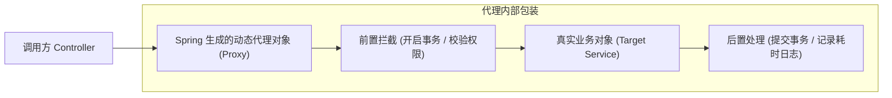

# 09. 元编程与切面：注解、反射与 Spring AOP 动态代理

> “PHP 靠魔术方法在运行时‘偷梁换柱’，Java 靠动态代理和字节码增强在启动时‘织入一切’。”

在 PHP 开发中，元编程几乎全靠“魔术”：`__call`、`__get`、`__set` 配合 Laravel 的 Facade 和 Eloquent 模型，让你能够写出像 `$user->orders()->whereStatus('paid')->get()` 这样极其流畅的代码。

然而，在严格强类型的 Java 中，**根本没有魔术方法**。如果类上没有这个方法，代码就无法通过编译。那么，像 Spring Boot 这样功能庞大、仅凭一个 `@Transactional` 就能管理数据库事务、凭一个 `@GetMapping` 就能自动映射 HTTP 请求的框架，究竟是如何施展魔法的？

答案就是三剑客：**注解（Annotation）**、**反射（Reflection）** 与 **动态代理（Dynamic Proxy / AOP）**。

---

## 1. 注解（Annotation）vs PHP 8 原生属性（Attribute）

PHP 8 引入的原生属性（Attributes，如 `#[Route('/api')]`）在设计哲学上几乎 1:1 借鉴了 Java 的注解体系。

注解本质上是**元数据标记**：它本身不包含可执行逻辑，只是依附在类、方法、字段或参数上的一段元信息，供编译器或运行时框架读取。

### 定义一个自定义限流注解：
```java
import java.lang.annotation.*;

// 1. 保留策略：RUNTIME 表示不仅编译到字节码中，JVM 运行期间还能通过反射读取到
@Retention(RetentionPolicy.RUNTIME)
// 2. 目标作用域：只能标注在方法上
@Target(ElementType.METHOD)
// 3. 允许继承
@Inherited
public @interface RateLimiter {
    // 定义注解属性，带默认值
    int limit() default 100;
    int timeoutSeconds() default 60;
    String key() default "";
}
```

### 使用注解标注业务方法：
```java
public class OrderController {
    @RateLimiter(limit = 10, timeoutSeconds = 1, key = "create_order")
    public String createOrder(Long userId) {
        return "订单创建成功";
    }
}
```

---

## 2. Java 反射机制（Reflection）

反射允许 Java 程序在运行状态中：
- 对于任意一个未知类，都知道其所有的构造器、成员变量和方法；
- 能够动态实例化对象，甚至强制访问被 `private` 封装的内部私有属性（通过 `setAccessible(true)`）。

### 反射实战：动态读取注解参数
```java
// 获取类和方法的元对象
Method method = OrderController.class.getMethod("createOrder", Long.class);

// 判断方法上是否存在 @RateLimiter 注解
if (method.isAnnotationPresent(RateLimiter.class)) {
    // 提取注解实例
    RateLimiter limiter = method.getAnnotation(RateLimiter.class);
    System.out.println("限流阈值: " + limiter.limit());
    System.out.println("限流时间窗口: " + limiter.timeoutSeconds());
}
```

> [!NOTE]
> 反射调用的性能比直接方法调用慢若干倍，但在现代 Spring 框架中，反射与元数据解析通常只在**应用启动期执行一次**并进行全量内存缓存，因此在平稳运行期对业务吞吐的影响微乎其微。

---

## 3. 动态代理：Spring AOP 的底层核心

在 PHP 中，横切关注点（Cross-Cutting Concerns，如鉴权、日志、请求拦截）主要依赖 **Middleware（中间件）** 或魔术方法。

在 Java 中，这一概念被称为 **AOP（Aspect-Oriented Programming，面向切面编程）**。Spring AOP 是通过动态代理在底层替你偷偷包装了一层“代理对象”来实现的。



### Java 两大动态代理流派：

1. **JDK 动态代理**：
   - 依赖 `java.lang.reflect.Proxy`；
   - **硬性前提**：目标类必须实现了一个或多个 `interface`；
   - 原理：在内存中动态生成一个实现了该接口的全新代理类。
2. **CGLIB / ByteBuddy 动态代理**：
   - 基于底层字节码生成技术；
   - **原理**：直接动态生成目标类的一个**子类（Subclass）**，并在子类中重写所有非 `final` 方法；
   - 目标类无需实现任何接口。Spring Boot 2.x/3.x 默认全面采用 CGLIB / ByteBuddy。

---

## 4. 实战：Spring AOP 打造统一方法执行耗时日志切面

使用注解驱动的切面开发，可以完全不用侵入原有业务代码：

```java
@Aspect
@Component
@Slf4j
public class TimeCostAspect {

    // 1. 定义切入点（Pointcut）：所有标注了 @RateLimiter 注解的方法
    @Pointcut("@annotation(com.tinywan.annotation.RateLimiter)")
    public void rateLimiterPointcut() {}

    // 2. 环绕通知（Around Advice）：包围目标方法的前后执行
    @Around("rateLimiterPointcut()")
    public Object recordCostTime(ProceedingJoinPoint joinPoint) throws Throwable {
        long start = System.currentTimeMillis();
        String methodName = joinPoint.getSignature().toShortString();

        try {
            // 执行真实业务目标方法
            return joinPoint.proceed();
        } finally {
            long cost = System.currentTimeMillis() - start;
            log.info("方法 [{}] 执行耗时: {} ms", methodName, cost);
        }
    }
}
```

---

## 5. 💣 核心避坑：自调用导致 AOP 代理失效

这是 90% 的初级 Java 工程师都会踩的大坑，在涉及 `@Transactional`（声明式数据库事务）或 `@Async` 时极为致命！

```java
@Service
public class UserService {

    // 外部 HTTP 请求直接调用的方法
    public void registerUser() {
        // ... 保存用户基本信息 ...

        // ❌ 灾难：直接自调用内部的带事务方法！
        this.sendRewardCoupon(); 
    }

    @Transactional
    public void sendRewardCoupon() {
        // 发送优惠券并记录资金流水，要求事务回滚
    }
}
```

> [!CAUTION]
> **为什么事务会失效？**  
> 因为 Spring 的事务是代理对象生效的。当通过 `this.sendRewardCoupon()` 调用时，是绕过了 Spring 代理、直接在内部纯对象上调用，因此**代理对象的开启和提交事务逻辑根本没有被触发！**
> 
> **解决方案**：
> 1. 将 `sendRewardCoupon` 剥离到独立的 Service 中并注入调用；
> 2. 或者通过 `AopContext.currentProxy()` 强行获取当前代理对象进行调用。

在下一章中，我们将深入探究 JVM 最受瞩目的核心内幕 —— **内存模型、堆栈划分与垃圾收集器调优**！
