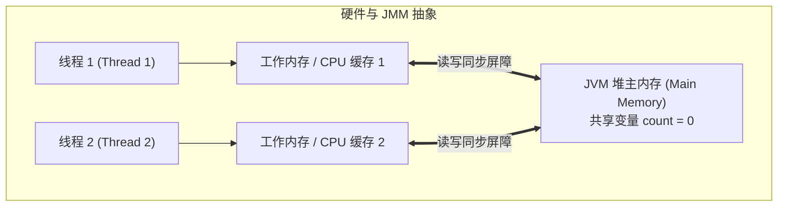
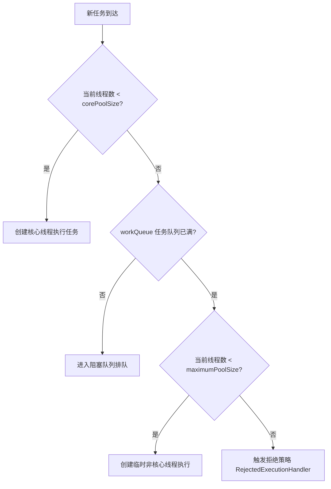

# 11. 并发与多线程：从 Shared-Nothing 到 JMM、线程池与锁

> “PHP 程序员靠 Redis 锁防止超卖，Java 工程师在微秒级的堆内存锁与 CAS 原子操作中守护一致性。”

在经典的 PHP-FPM 模式下，并发实际上是**“多进程并发”**：
- 操作系统拉起 100 个 PHP-FPM 子进程；
- 每个进程各自占用几十兆独立内存，互不通信；
- 一旦涉及并发抢购、库存扣减，PHP 开发者必须将请求扔给外部中间件，使用 Redis 分布式锁（`SETNX`）或者 MySQL 行级悲观锁（`SELECT ... FOR UPDATE`）进行协调。

而在 Java 的常驻服务中，并发是**“单进程内的多线程并发”**：
- 数千个工作线程并发运行在同一个 JVM 进程中，**共同读写同一片堆内存空间**；
- 线程间通信无需跨越网络，耗时以纳秒计算；
- 但如果缺少正确的同步机制，多个线程同时修改同一变量将引发极难复现的脏写、死锁与内存竞态（Race Condition）。

本章将带你系统掌握 Java 内存模型（JMM）、线程同步锁、原子操作以及工业级线程池的配置准则。

---

## 1. Java 内存模型（JMM）与三大特性

由于现代多核 CPU 拥有多级高速硬件缓存（L1/L2/L3 Cache），每个线程在执行代码时，会先将主内存（Main Memory）中的变量拷贝一份副本到自己的**工作内存（CPU 寄存器与缓存行）**中进行运算。



JMM 规定了线程之间何时能够感知到彼此修改的变量，围绕三大特性展开：
1. **可见性（Visibility）**：一个线程修改了共享变量的值，其他线程能够立即看到最新的修改；
2. **原子性（Atomicity）**：一个或一组操作要么全部执行且执行过程不受任何干扰，要么全不执行；
3. **有序性（Ordering）**：编译器与 CPU 为了优化性能，可能会对指令进行**指令重排（Instruction Reordering）**。

### `volatile` 关键字的神奇语义：
- **保证可见性**：一旦变量被 `volatile` 修饰，任何线程对它的写操作都会立刻强制刷回主内存，且导致其他线程的 CPU 缓存行失效；
- **禁止指令重排**：通过底层插入内存屏障（Memory Barrier），防止关键指令次序颠倒（如经典的双重检查锁定单例）。

> [!CAUTION]
> **`volatile` 无法保证原子性！**  
> 很多初学者以为写了 `volatile int count = 0;` 就能线程安全地执行 `count++`。  
> 实际上，`count++` 包含三个机器步骤：读取值 -> 加一 -> 写回值。如果两个线程同时读取到旧值，写回依然会发生覆盖！

---

## 2. 线程同步锁与 CAS 原子操作

为了保证操作的绝对原子性，Java 提供了悲观锁与乐观锁两套成熟体系：

### 1. 内置关键字 `synchronized`（悲观互斥锁）
可以直接修饰方法或代码块，由 JVM 保证同一时刻只有一个线程能够持有锁并进入临界区：

```java
public class StockService {
    private int stock = 100;

    // 线程安全的方法
    public synchronized boolean deductStock(int count) {
        if (this.stock >= count) {
            this.stock -= count;
            return true;
        }
        return false;
    }
}
```

> [!NOTE]
> 现代 JVM 对 `synchronized` 做了极其强悍的优化（锁升级机制：无锁 -> 偏向锁 -> 轻量级自旋锁 -> 重量级 OS 互斥锁）。在低冲突和短临界区场景下，性能几乎接近原生无锁。

### 2. JUC 原子类（基于 CPU 底层 CAS 的乐观并发）
对于纯数值的并发自增、扣减，Java 提供了 `java.util.concurrent.atomic` 工具包。其底层利用 CPU 的 `CMPXCHG`（比较并交换）指令，**零锁开销**：

```java
// 高并发秒杀计数器
public class Counter {
    private final AtomicInteger count = new AtomicInteger(0);

    public int increment() {
        return count.incrementAndGet(); // 硬件级原子递增，绝对线程安全！
    }
}
```

> [!TIP]
> 如果并发写入极其密集（例如每秒数十万次计数），推荐使用 **`LongAdder`**。它通过内部类似分段槽（Cells）的设计分散写冲突，性能显著优于 `AtomicLong`。

---

## 3. 生产级线程池（ThreadPoolExecutor）配置准则

在 PHP 中，需要异步执行任务通常只能将任务序列化写入 RabbitMQ / Redis 队列，再由外部的 `php artisan queue:work` 消费。

在 Java 中，可以直接在 JVM 内部创建**线程池**，由工作线程异步高效执行任务。



> [!CAUTION]
> **阿里巴巴 Java 开发手册严禁规则**：  
> 绝对严禁使用 `Executors.newFixedThreadPool()` 或 `Executors.newCachedThreadPool()`！  
> 因为它们底层使用的是无界队列（`LinkedBlockingQueue` 默认容量为 $2^{31}-1$）或无限制创建线程，突发高并发时会堆积几百万个任务，直接将堆内存挤爆抛出 OOM！

### 规范推荐的标准线程池构建方式：
```java
@Configuration
public class ThreadPoolConfig {

    @Bean("businessExecutor")
    public ThreadPoolExecutor businessExecutor() {
        return new ThreadPoolExecutor(
            8,                                      // 1. 核心线程数 (Core Pool Size)
            16,                                     // 2. 最大线程数 (Max Pool Size)
            60, TimeUnit.SECONDS,                   // 3. 非核心线程空闲存活时间
            new ArrayBlockingQueue<>(500),          // 4. 有界阻塞队列，容量 500！
            new ThreadFactoryBuilder()
                .setNameFormat("biz-thread-%d")     // 5. 必须为线程赋予有意义的名字，方便查日志
                .build(),
            new ThreadPoolExecutor.CallerRunsPolicy() // 6. 拒绝策略：队列满时由调用方主线程兜底执行，防止丢数据
        );
    }
}
```

---

## 4. 现代异步编排：`CompletableFuture`

当你需要同时发起多个外部 RPC 调用（比如并行查询商品信息、优惠券、运费计算），并在全部获取完毕后组装返回时，PHP 往往必须依赖 Swoole/Fibers 协程。

Java 原生提供了极其流畅的链式响应编排工具 **`CompletableFuture`**：

```java
// 1. 异步查询商品详情 (交由指定线程池执行)
CompletableFuture<Product> productFuture = CompletableFuture.supplyAsync(
    () -> productService.queryProduct(productId), businessExecutor
);

// 2. 异步查询用户可用优惠券
CompletableFuture<Coupon> couponFuture = CompletableFuture.supplyAsync(
    () -> couponService.queryUserCoupon(userId), businessExecutor
);

// 3. 合并两个异步结果并计算最终实付价格
CompletableFuture<OrderPreviewVo> resultFuture = productFuture.thenCombine(
    couponFuture, 
    (product, coupon) -> new OrderPreviewVo(product, coupon, calculatePrice(product, coupon))
);

// 获取最终组装好的数据（带 2 秒超时保护）
OrderPreviewVo preview = resultFuture.get(2, TimeUnit.SECONDS);
```

下一章中，我们将迎来 Java 21 最震撼的现代特性 —— **虚拟线程（Project Loom）**，看看它如何以同步代码的编写体验颠覆高并发世界！
