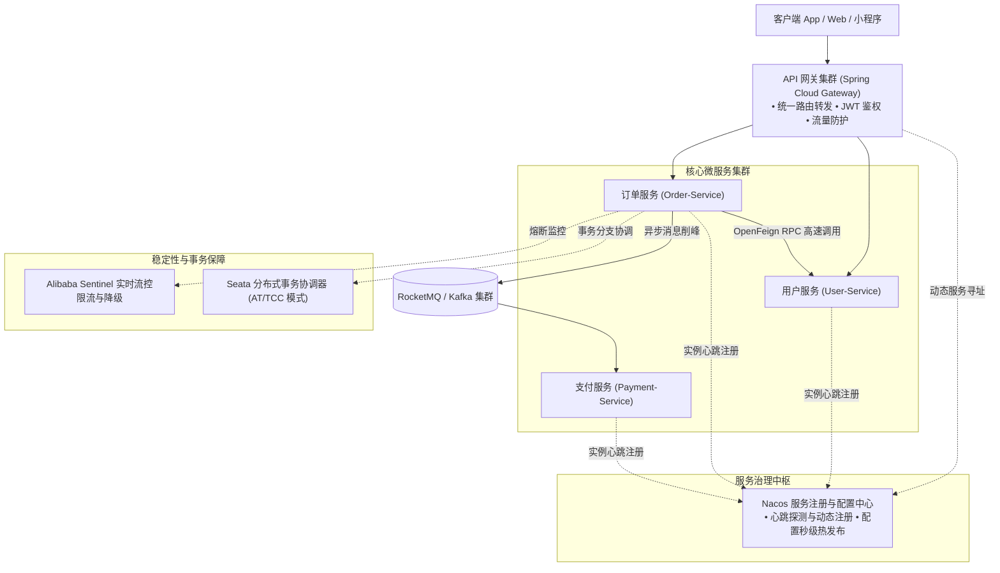
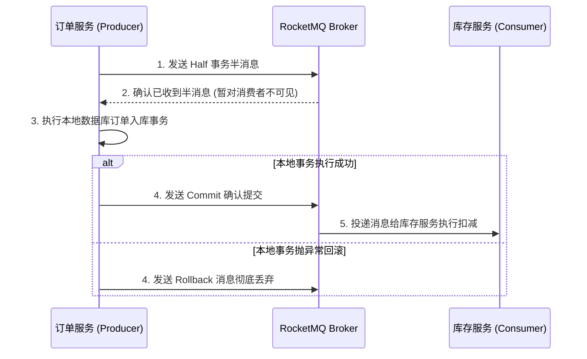

# 15. 企业级微服务全家桶：Nacos、Gateway、RocketMQ 与高可用

> “单体架构的单点崩溃让人夜不能寐，工业级微服务集群的自我愈合让团队安枕无忧。”

在 PHP 技术栈中，最经典的架构是 **Nginx + PHP-FPM + MySQL + Redis**。随着业务线扩张，很多团队尝试将单体拆分为多个子系统，通常依靠 Nginx 反向代理或硬编码内网 IP 进行 HTTP 互调。

但当服务节点数量从十几个暴增到几百个，频繁扩缩容、配置热更新、流量削峰填谷、跨服务一致性事务等难题接踵而至，手工运维与硬编码配置迅速崩溃。

Java 生态拥有全球规模最大、经过“双十一”等千亿级流量实战洗礼的微服务治理体系 —— **Spring Cloud Alibaba** 与 **Spring Cloud 原生全家桶**。

本章将系统拆解微服务架构的核心支柱，助你建立顶层分布式系统架构视野。

---

## 1. 企业级微服务全景架构拓扑



---

## 2. 服务注册与动态发现：Nacos

在 PHP 中，如果给用户服务新增了 3 台机器，通常需要手动修改 Nginx 的 `upstream` 配置文件并 `nginx -s reload`。

在微服务中，引入了 **Nacos**：
- **服务自注册**：任何一个 Spring Boot 微服务实例启动时，会自动向 Nacos 注册自己的 IP、端口与健康状态；
- **健康心跳探测**：服务每隔 5 秒向 Nacos 发送心跳；一旦宕机，Nacos 会在秒级内将该节点踢出可用列表；
- **客户端负载均衡**：调用方（如订单服务）通过服务名（`user-service`）即可自动向健康实例发起轮询或加权调用。

### 接入只需一个注解与配置：
```yaml
# application.yml
spring:
  cloud:
    nacos:
      discovery:
        server-addr: 192.168.1.100:8848 # Nacos 服务端地址
```

---

## 3. 声明式 RPC 调用：OpenFeign vs PHP Guzzle

在 PHP 中跨服务调用通常需要使用 Guzzle 手写 HTTP 请求并自行解析 JSON。

在 Spring Cloud 中，使用 **OpenFeign**，只需像定义本地接口一样，框架在底层自动完成服务发现、负载均衡、序列化与网络请求：

```java
// 声明调用 user-service 服务的 Feign 客户端
@FeignClient(name = "user-service", fallback = UserFeignFallback.class)
public interface UserFeignClient {

    @GetMapping("/api/v1/users/{id}")
    ApiResponse<UserVo> getUserById(@PathVariable("id") Long id);
}
```

```java
// 在订单业务中直接当成本地 Bean 注入使用！
@Service
@RequiredArgsConstructor
public class OrderService {
    private final UserFeignClient userFeignClient;

    public void createOrder(Long userId) {
        // 像调用本地方法一样调用远程服务！
        ApiResponse<UserVo> userRes = userFeignClient.getUserById(userId);
    }
}
```

---

## 4. 异步削峰与分布式事务消息：RocketMQ

在电商秒杀场景中，海量并发下单请求直接涌入数据库会瞬间引发死锁和崩溃。

Java 生态普遍采用阿里开源的工业级消息中间件 **Apache RocketMQ**：
- **极致吞吐**：单机轻松承载 10 万+ QPS 写入；
- **事务消息（Transactional Message）**：原生支持分布式事务最终一致性（解决“本地数据库扣款成功但 MQ 消息发送失败”或“MQ 消息发送成功但本地事务回滚”的一致性难题）。



---

## 5. 高可用防护神：Sentinel 限流与熔断

当某个下游服务（如外部支付网关）由于网络故障发生严重超时时，如果不做防护，调用方的并发线程池会被迅速耗尽，最终引发整个微服务集群的**雪崩效应（Cascading Failure）**。

Alibaba **Sentinel** 提供了可视化的流控与熔断降级能力：
- **QPS 限流**：限制某个 API 每秒最多接收 2000 个请求，超出部分直接快速失败或排队等待；
- **熔断降级**：当接口的慢调用比例超过 50% 时，自动开启熔断器，在接下来的 10 秒内直接走降级逻辑（Fallback），保护底层数据库不被打死。

```java
@SentinelResource(value = "createOrder", fallback = "createOrderFallback")
public String createOrder(Long userId, Long productId) {
    // 核心下单逻辑...
}

// 降级兜底方法：当被限流或接口异常时秒级触发
public String createOrderFallback(Long userId, Long productId, Throwable ex) {
    return "当前排队人数过多，请稍候再试（系统降级保护中）";
}
```

在下一章中，我们将梳理 **全书核心罗塞塔石碑（Rosetta Stone）速查表与 PHP 开发者踩坑 Top 20**！
