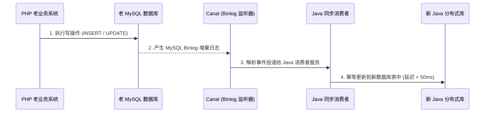

# 17. 综合实战与平滑迁移：绞杀者模式重构核心业务实战

> “任何企图在一夜之间推翻重写老系统的尝试，90% 都会以延期、故障甚至项目流产告终。真正的架构师依靠‘绞杀者模式’在飞行中更换客机引擎。”

当你学完了 Java 的语法、并发、JVM 以及 Spring Boot 微服务生态之后，你面临的最大考验往往是：**“如何把现有的 PHP 线上核心业务系统，稳健、无故障、平滑地迁移到 Java 新架构中？”**

如果直接进行全面重写（Big-Bang Rewrite）：
- 业务需求将被迫冻结数月，无法响应市场变化；
- 老系统中沉淀了无数边缘边界逻辑与“暗坑”，新系统极易遗漏引发重大故障；
- 一旦上线失败，团队将承受巨大的信任危机。

本章将为你传授业界最成熟的系统演进战略 —— **绞杀者模式（Strangler Fig Pattern）**，并结合完整架构方案演练落地。

---

## 1. 绞杀者模式演进五步法

```mermaid
flowchart TD
    subgraph 阶段 1：边界勘界与网关拦截
        G1[统一网关 Gateway] --> P1[老 PHP 单体核心]
    end

    subgraph 阶段 2：CDC 数据双向同步
        P2[老 PHP 系统] <== Canal / Binlog 数据实时双写同步 ==> J2[新 Java 核心库]
    end

    subgraph 阶段 3：旁路代理与流量分流
        G3[网关流量切换] -- 90% 流量 --> P3[老 PHP 系统]
        G3 -- 10% 灰度流量 --> J3[新 Java 微服务]
    end

    subgraph 阶段 4：全面接管与老系统下线
        G4[统一网关 Gateway] --> J4[新 Java 微服务集群]
        P4[老 PHP 模块彻底退役下线 🎉]
    end

    阶段 1：边界勘界与网关拦截 --> 阶段 2：CDC 数据双向同步
    阶段 2：CDC 数据双向同步 --> 阶段 3：旁路代理与流量分流
    阶段 3：旁路代理与流量分流 --> 阶段 4：全面接管与老系统下线
```

---

## 2. 关键技术方案一：无侵入数据实时同步（Canal / CDC）

迁移过程中最棘手的问题是**数据一致性**：新老系统必须在一段时间内共存，且双方对数据的读写必须实时互通。

严禁在 PHP 业务代码中手写“双写”（同时写老库又写新库），因为网络抖动必然导致单边失败与数据分裂。

推荐方案是使用阿里开源的 **[Canal](https://github.com/alibaba/canal)** 伪装成 MySQL 的从库，监听 Binlog 增量变更，将数据近实时异步推送到 Java 新库：



---

## 3. 关键技术方案二：PHP 与 Java 高性能互调（gRPC）

在阶段二与阶段三，PHP 依然负责处理前台页面渲染或复杂的业务编排，而核心计算逻辑（如风控评分、高并发秒杀排队、库存扣减）已经由 Java 重构完成。

此时，推荐使用由 Google 主导的 **gRPC（基于 HTTP/2 与 Protobuf 二进制序列化）** 作为 PHP 与 Java 的跨语言通信总线。

### 1. 编写通用的契约文件：`order_service.proto`
```protobuf
syntax = "proto3";

package com.tinywan.rpc;

service OrderRpcService {
    rpc CheckStockAndDeduct (DeductRequest) returns (DeductResponse);
}

message DeductRequest {
    int64 product_id = 1;
    int32 count = 2;
}

message DeductResponse {
    bool success = 1;
    string message = 2;
}
```

### 2. Java 端提供高性能 gRPC 服务端实现：
```java
@GrpcService // Spring Boot gRPC 注解，自动暴露端口
public class OrderRpcServiceImpl extends OrderRpcServiceGrpc.OrderRpcServiceImplBase {

    @Autowired
    private StockService stockService;

    @Override
    public void checkStockAndDeduct(DeductRequest request, StreamObserver<DeductResponse> responseObserver) {
        boolean ok = stockService.deductStock(request.getProductId(), request.getCount());

        DeductResponse response = DeductResponse.newBuilder()
            .setSuccess(ok)
            .setMessage(ok ? "扣减成功" : "库存不足")
            .build();

        responseObserver.onNext(response);
        responseObserver.onCompleted();
    }
}
```

### 3. PHP 端极速调用 Java gRPC 服务：
```php
// PHP 利用 grpc 扩展直接发起强类型调用
$client = new \Com\Tinywan\Rpc\OrderRpcServiceClient('127.0.0.1:9090', [
    'credentials' => \Grpc\ChannelCredentials::createInsecure(),
]);

$request = new \Com\Tinywan\Rpc\DeductRequest();
$request->setProductId(10086);
$request->setCount(2);

// 发起二进制高速调用（单次耗时通常在 2ms 以内！）
list($reply, $status) = $client->CheckStockAndDeduct($request)->wait();

if ($reply->getSuccess()) {
    echo "PHP 成功调用 Java 核心: " . $reply->getMessage();
}
```

---

## 4. 灰度切流与上线检查清单（Checklist）

在网关层执行流量切换前，请严格对照以下安全清单：

- [ ] **数据比对自动化**：新老数据库已挂载对账脚本，全量与增量数据不一致率达到 0%；
- [ ] **接口压测达标**：Java 新服务在真实压力机下进行压测，QPS 达到老 PHP 系统的 3~5 倍以上，P99 延迟稳定在合理区间；
- [ ] **日志与追踪齐备**：接入链路追踪（如 Apache SkyWalking），PHP 端透传 `traceId` 到 Java 端，排障链路不断裂；
- [ ] **一键回滚预案建立**：网关规则已预设秒级回滚配置，若灰度 10% 流量发现异常，可在 5 秒内将全部流量无损切回老 PHP 系统。

---

## 5. 结语：拥抱更广阔的工程天地

恭喜你！完成本书的系统学习后，你已经完成了从单一的**脚本开发思维**到**企业级系统架构设计**的蜕变。

- 你保留了 PHP 敏捷、极速、一切为了业务交付的强大优势；
- 同时补齐了 Java 强类型、常驻内存、多线程并发、JVM 调优与大规模微服务集群治理的核心硬实力。

技术的本质不是宗派之争，而是**在最适合的场景下，选用最契合的工具交付最具价值的业务产品**。愿你在未来的架构师之路上，乘风破浪，行稳致远！
