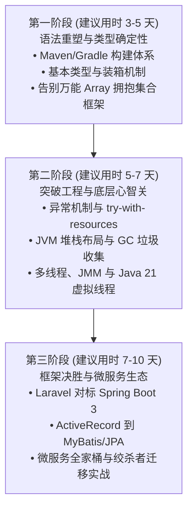

# 前言：写给 PHP 开发者的 Java 进阶指南

欢迎来到 **《Java for PHP Programmers》**。

这是一本专为拥有 **PHP 8+ / Laravel / Symfony / ThinkPHP / Workerman / Webman / Swoole** 背景的开发者量身打造的现代 Java 企业级系统开发指南。全书针对动态弱类型、单请求生命周期（Shared-Nothing）以及依赖外部缓存（Redis）协调状态的思维定势，提供系统化、渐进式的工程化重塑方案。

---

## 为什么写这本书？

过去二十年里，PHP 凭借极低的上手门槛、无与伦比的迭代效率以及“单请求即销毁（Shared-Nothing）”带来的天然内存隔离，支撑了全球亿万级 Web 业务的极速爆发。

然而，随着互联网业务规模的不断膨胀，面对分布式微服务治理、海量并发连接、金融级强一致性事务以及高吞吐流处理时，纯 PHP 架构开始显现出明显的**工程与性能瓶颈**：

1. **单请求生命周期的两难境地**：
   - 传统的 PHP-FPM 模式下，每个请求都要重新加载框架、连接池无法跨请求常驻（或依赖外部代理如 ProxySQL），面对高频调用开销显著；
   - 在常驻内存框架（如 Swoole / Workerman）中，虽然并发吞吐大幅提升，但多进程下的状态共享、全局静态变量内存泄露、阻塞调用拖垮 EventLoop 等陷阱给团队运维带来了巨大心智负担。
2. **缺乏系统级线程与内存原语**：
   - PHP 没有语言层面的多线程共享内存模型（JMM），跨请求通信几乎只能依赖 Redis / MQ 等外部中间件，增加了架构延迟与网络跳数；
   - 面对复杂的内存缓存（如百兆级热点数据缓存、LRU 本地淘汰），PHP 的进程间共享内存方案（APCu、Swoole Table）在使用体验与功能完整度上与 JVM 堆内缓存（如 Caffeine）差距明显。
3. **企业级微服务生态与强一致性事务治理**：
   - 当单体系统拆分为几十上百个微服务时，服务注册与发现（Nacos/Consul）、配置中心动态推送、分布式事务（Seata 2PC/TCC）、复杂分库分表（ShardingSphere）、消息削峰与可靠投递（RocketMQ/Kafka）等领域，Java 生态拥有历经全球最大规模真实业务锤炼的工业级解决方案。

**现代 Java（Java 17/21+）早已不是记忆中那个繁琐迟钝的古老语言。** 
引入了 **Record 不可变数据载体**、**模式匹配（Pattern Matching）**、**文本块（Text Blocks）** 以及革命性的 **虚拟线程（Project Loom）** 之后，现代 Java 在兼具极致工程严谨性与强类型安全的同时，展现出了空前的开发体验与并发性能。

更重要的是，**PHP 与 Java 绝非水火不容的对立面，而是企业级架构中的最佳拍档**：
- **PHP**：负责极速敏捷的前台业务组装、BBS/CMS、营销活动快速迭代、BFF（Backend for Frontend）聚合层；
- **Java**：负责交易核心、资金账户、微服务底层引擎、高并发排队网关以及流式数据分析中心。

---

## 学习路线与节奏建议（Pacing Guide）

本书分为三个进阶阶段，共 17 个核心章节。我们建议您按照以下节奏展开自学或团队技术进阶：

| 阶段 | 涵盖章节 | 核心学习目标 | 检验标志（Checkpoint） |
| :--- | :--- | :--- | :--- |
| **第一阶段：语法重塑** | 第 01 ~ 06 章 | 熟悉 Maven/Gradle 与现代 JDK 21，掌握强类型、集合体系与面向对象契约 | 能熟练使用 Maven 构建工程，用 Record 和集合类写出无类型警告的严谨代码 |
| **第二阶段：突破底层** | 第 07 ~ 12 章 | **核心攻坚**：深入 JVM 内存模型、GC 回收机制、多线程并发与 Java 21 虚拟线程 | 能向同事清晰阐述 JVM 堆栈内存划分，排查一次简单的死锁或线程安全隐患 |
| **第三阶段：架构融合** | 第 13 ~ 17 章 | Spring Boot 3 与 Laravel 映射、MyBatis 持久化、微服务治理与平滑重构 | 能用 Spring Boot 3 + Nacos + RocketMQ 搭建生产级微服务，并与 PHP 系统互通 |

---

## 核心心智模型切换法则

在开始阅读后续章节前，请务必牢记以下三条心智切换黄金法则：

> [!IMPORTANT]
> **法则一：从“请求结束即销毁”到“常驻生命周期”**  
> 在 PHP-FPM 中，变量未 unset 或连接未显式关闭，请求结束后 Zend 引擎都会替你清理。但在 Java 的 JVM 中，进程长年累月运行，静态变量（`static`）与未关闭的流（Stream/Socket）会持续占用堆内存，随时可能诱发致命的 `OutOfMemoryError`。

> [!TIP]
> **法则二：告别“一个万能 Array 走天下”**  
> PHP 的 `array` 既能当列表，又能当哈希字典，还能充当队列与栈。在 Java 中，必须根据**访问频次**、**插入顺序**、**唯一性**与**并发安全**，精准选择 `ArrayList`、`HashSet`、`HashMap` 或 `ConcurrentHashMap`。

> [!NOTE]
> **法则三：将编译期拦截视为最高效的保护**  
> PHP 的许多类型错误只有代码执行到对应行时才会暴露（Runtime Error）。Java 的静态类型与泛型检查可能在编译阶段让你多花几秒解决语法报错，但它能在上线前彻底消灭 80% 以上低级类型不匹配与方法不存在的隐患。

现在，让我们翻开第一章，开启通往 Java 企业级工业世界的大门！
